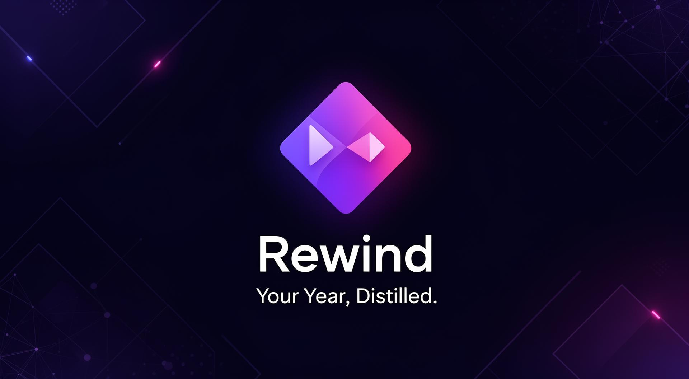

# Rewind — Your Journey, Distilled. Your Future, Designed.

Spotify Wrapped meets personal growth. Rewind walks you through a guided reflection on your year (or any season), turns your answers into cinematic, shareable cards, and then helps you design a **Blueprint**: an AI-written action plan with goals, notes and reminders. It's meant as a lifetime companion: the questions aren't tied to a specific year.

Live: **[rewindsite.vercel.app](https://rewindsite.vercel.app)**



## Features

**Reflection journey**
- Guided questions (26 in `src/data/questions.ts`) across life categories, with animated category transitions and a progress bar
- Answers save as you type, and you can resume where you left off
- Multi-select questions, swipe navigation on mobile, Zod validation on every input

**Wrapped**
- Animated cards that summarise your reflection, with swipe, keyboard (arrows, Home/End) and button navigation
- Download one card or all of them as images, sized for each social platform, and share to X and LinkedIn

**Blueprint**
- An AI-generated plan built from your answers
- Goals with categories, target dates and status; notes with tags; reminder settings
- Email a blueprint to someone (Resend), compare blueprints over time, export goals to PDF

**Profile**
- Display name, 48 preset emoji avatars, 28 preset descriptions, streak tracking

**Landing page**
- Hero, Wrapped demo, how it works, app-flow demo, features, pricing, FAQ

## Stack

| | |
|---|---|
| Frontend | React 18, TypeScript, Vite, React Router, TanStack Query, Framer Motion |
| UI | Tailwind CSS, shadcn/ui (Radix), Lucide, Recharts, html2canvas, canvas-confetti |
| API | Vercel serverless functions in `api/` |
| Database | Turso (libSQL). Schema in `db/migrations/001_initial.sql` |
| Auth | Email + password, bcrypt-hashed, JWT sessions (30 days) |
| AI | Lovable AI gateway (OpenAI-compatible chat completions) |
| Email | Resend |

## History

- **Dec 2025:** built with [Lovable](https://lovable.dev) on Lovable Cloud (Supabase).
- **31 Dec 2025:** reworked from a one-off year-end review into a lifetime tool.
- **Jun 2026:** moved off Supabase to Turso with Vercel API routes. `src/integrations/supabase/client.ts` is now a thin alias for the new API client (`src/lib/api-client.ts`), so the components didn't need rewriting.

Not carried over in that move yet:
- **Custom avatar upload.** Storage is stubbed in the API client, so preset avatars work but uploaded photos aren't saved.
- **Weekly reminder emails.** They were a Supabase edge function. Reminder settings are still stored, but no scheduled job sends them.

## API

All data routes need `Authorization: Bearer <token>`.

| Route | |
|---|---|
| `POST /api/auth/signup`, `POST /api/auth/login`, `GET /api/auth/session` | Account and session |
| `GET/POST/PATCH/DELETE /api/data/<table>` | CRUD on the user's own rows (`profiles`, `reflections`, `reflection_answers`, `blueprints`, `blueprint_notes`, `blueprint_reminders`, `blueprint_goals`). Every query is scoped to the signed-in user, and column names are validated before they reach SQL. |
| `POST /api/generate-blueprint` | Generate a blueprint from the user's answers |
| `POST /api/send-blueprint-email` | Email a blueprint |

## Run it locally

```bash
npm install
npm run dev        # frontend only (Vite)
npm run dev:full   # frontend + API routes (vercel dev)
npm run db:migrate # apply db/migrations/001_initial.sql to a Turso database named "rewind"
```

## Environment variables

| Variable | Used by | Purpose |
|---|---|---|
| `TURSO_DATABASE_URL`, `TURSO_AUTH_TOKEN` | API | Database |
| `JWT_SECRET` | API | Signs sessions (required; the API refuses to run without it) |
| `LOVABLE_API_KEY` | API | AI gateway for blueprint generation |
| `RESEND_API_KEY` | API | Blueprint emails |
| `SITE_URL` | API | Link used in emails |
| `VITE_API_URL` | Frontend | API base URL (defaults to `/api`) |
| `VITE_SITE_URL` | Frontend | Public site URL |

Set them in the Vercel project, or locally in a `.env.local` file (git ignores it).

## Licence

Copyright © 2025–2026 Kennedy Muritu. All rights reserved. The code is public to read, not to reuse. See [LICENSE](LICENSE).
